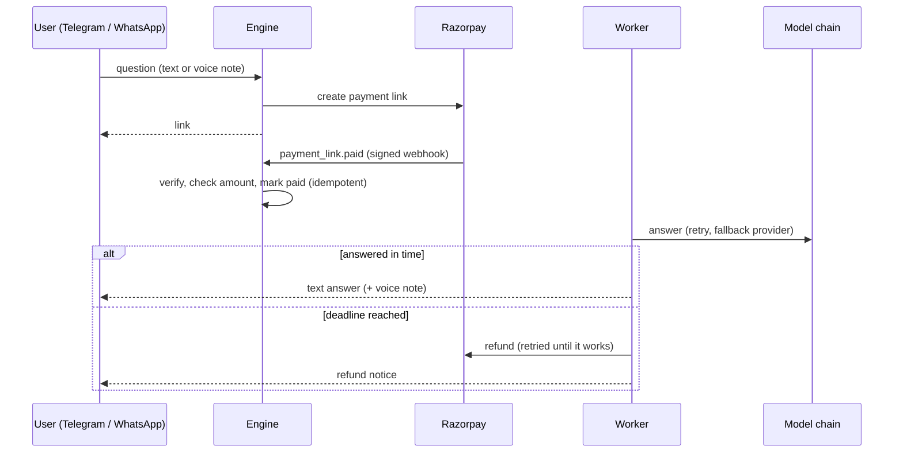

# PaidAnswer

**Pay-per-answer AI chatbot core for Telegram and WhatsApp, with one tested promise: a user who paid gets an answer or a refund, exactly once.**

A user asks a question, pays through a payment link, and gets an AI answer (text, optionally a voice note). The hard part of this kind of product is not the AI call. It is what happens when something breaks *after the money has been taken*: the model times out, the webhook is delivered twice, the server restarts, the user's chat cannot be reached. PaidAnswer is built around those cases and proves them with 21 failure scenarios.

[Live scorecard](docs/index.html) · MIT license · Python 3.10+ · one dependency (`requests`)

## The guarantee

Once a payment is recorded, the order ends as **delivered** or **refunded**. Never neither, never both, and the answer reaches the user once.

How it is enforced:

- **Signed webhooks only.** Razorpay (`X-Razorpay-Signature`), WhatsApp (`X-Hub-Signature-256`) and Telegram (secret token) are verified in constant time. Forged requests change nothing.
- **Idempotent payments.** A payment id can mark an order paid only once. Replayed webhooks, duplicate events and double payments are detected; an extra payment is refunded automatically.
- **Amount check.** A payment with the wrong amount is refunded, not fulfilled.
- **State lives in the database, not in memory.** Work is a leased queue in SQLite. If a worker crashes after taking an order, the lease expires and another worker finishes it. A restart loses nothing.
- **Retries, fallback, deadline.** The model call is retried with backoff and falls back to the next provider. Delivery is retried. If nothing works before the deadline (default 10 minutes), the payment is refunded and the user and the admin are told. A failing refund API is retried until it succeeds.

## How it works



Voice questions are transcribed only after payment. Premium topics (configurable keywords) get a higher price before the model is called.

## Try it in 30 seconds (no keys, no network)

```bash
pip install .
python -m paidanswer demo          # two narrated stories: a retry, and an outage that ends in a refund
python -m paidanswer resilience    # runs all 21 failure scenarios
python -m paidanswer resilience --html scorecard.html
python -m unittest discover -s tests
```

On Windows use `py -m paidanswer demo` and so on.

## Going live

1. `cp .env.example .env` and fill it in. At least: Razorpay keys, one channel, one model.
2. Start the server: `python -m paidanswer serve --env-file .env --port 8080`
   (or run `paidanswer.web.WebApp` under any WSGI server). It must be reachable over HTTPS; use a tunnel while testing.
3. Register the webhooks:
   - **Razorpay:** dashboard → Webhooks → URL `https://YOUR_HOST/webhooks/razorpay`, your secret, event `payment_link.paid`.
   - **Telegram:** `https://api.telegram.org/bot<TOKEN>/setWebhook?url=https://YOUR_HOST/webhooks/telegram&secret_token=<TELEGRAM_WEBHOOK_SECRET>`
   - **WhatsApp Cloud API:** Meta app → WhatsApp → Configuration → callback URL `https://YOUR_HOST/webhooks/whatsapp`, your verify token, subscribe to `messages`.
4. Check `GET /healthz`. Order list for the admin: `GET /admin/orders` with `Authorization: Bearer <ADMIN_TOKEN>`.
5. **Smoke-test with real credentials in test mode before charging anyone** (see "What is and is not tested").

## Configuration

Everything is an environment variable; see [`.env.example`](.env.example). Prices, premium keywords, deadline, system prompt file, voice replies and the model order are all configurable. Model names are never hard-coded: set the current names from your provider's documentation.

## What is and is not tested

**Tested here (no network, fake clock):** the engine, the order state machine, retries, fallback, refunds, crash recovery, webhook verification, deduplication, the HTTP layer, request shapes of every adapter. 21 scenarios (133 checks) plus 29 unit tests, including two database connections racing for the same orders.

I also checked that the scenarios catch real bugs by breaking the engine on purpose (no payment idempotency, no refund at the deadline, no crash recovery); each mutation was caught.

**Not tested here:** the live adapters against the real Telegram, WhatsApp, Razorpay, Gemini, Anthropic and Google APIs. They are written from the providers' documented request formats and unit-tested for request shape, but nobody has run them against the real services in this repository. Run the smoke test with test-mode credentials first.

## Known limits

- **WhatsApp 24-hour window.** Free-form replies work only within 24 hours of the user's last message. If a user pays after the window closed, the answer cannot be sent; the order ends in an automatic refund. Sending approved templates is not implemented.
- **Voice notes** are sent as OGG/Opus. Transcription and speech synthesis use Gemini and Google Text-to-Speech; other providers need a small adapter.
- **Delivery is at-least-once.** A crash between sending the answer and saving that fact can send it twice. Inbound chat messages are at-most-once (a lost message just means the user asks again).
- **Premium pricing** looks at the text of the question; a voice question is priced at the base price.
- **Privacy.** Questions and answers are stored in the SQLite database. Decide on retention and tell your users.
- This is a software component, not legal or consumer-protection advice. Refund and invoicing rules depend on your country.

## Security notes

Secrets only in the environment, never in the repository. Webhooks are verified before anything is parsed into state. The admin endpoint needs a bearer token. Request bodies are capped at 1 MB. The server logs no message content at INFO level.

## Project layout

```
paidanswer/engine.py     the engine and the worker loop
paidanswer/store.py      SQLite state machine (guarded transitions, leased queue)
paidanswer/web.py        WSGI app: webhooks, health, admin
paidanswer/channels.py   Telegram and WhatsApp adapters and parsers
paidanswer/payments.py   Razorpay links, refunds, signature check
paidanswer/llm.py        model chain, Gemini and Anthropic adapters
paidanswer/speech.py     optional text to speech and speech to text
paidanswer/scenarios.py  the 21 failure scenarios (also the tests' source of truth)
paidanswer/report.py     HTML scorecard
tests/                   unittest suite
```

## License

MIT. See [LICENSE](LICENSE).
